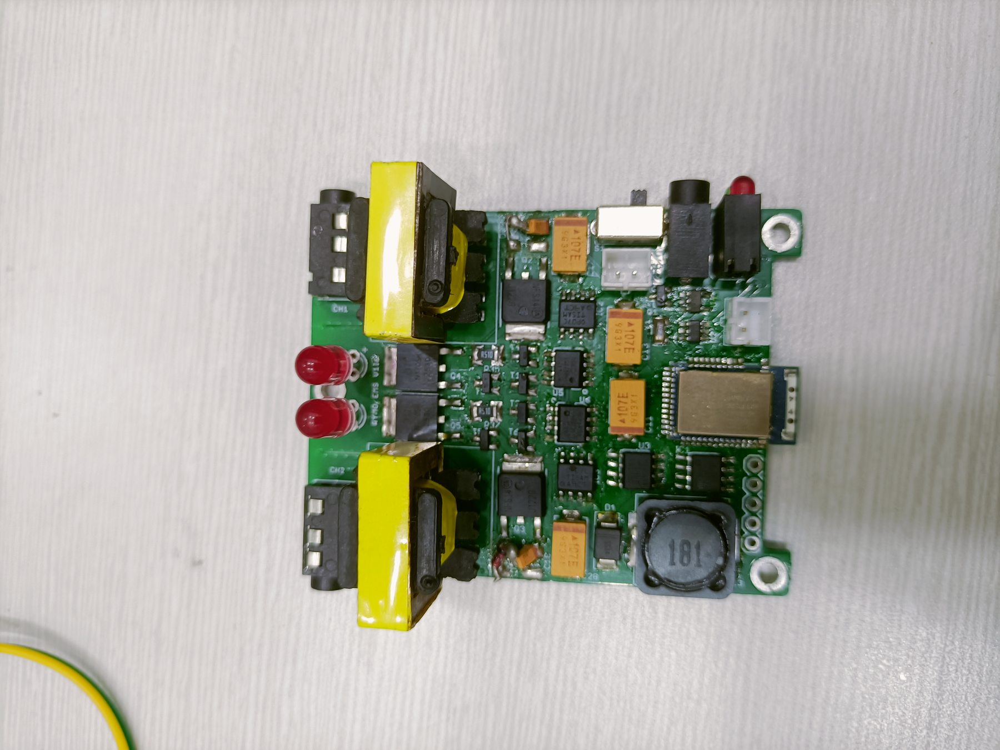
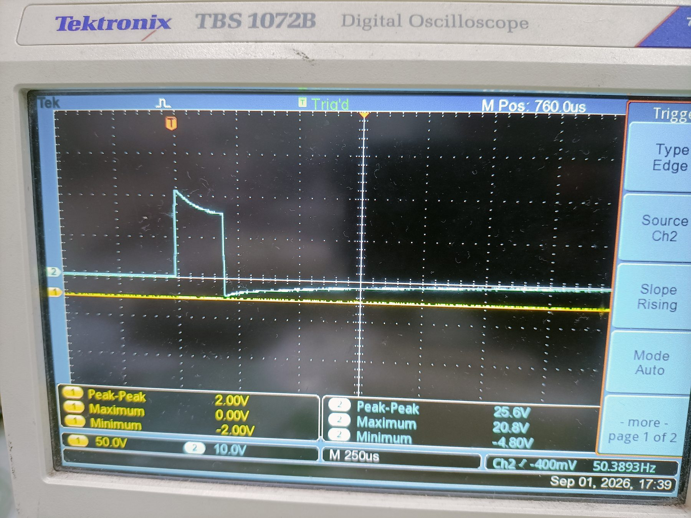
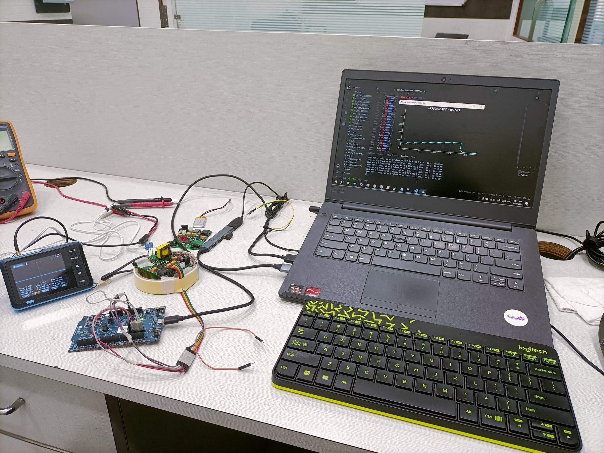
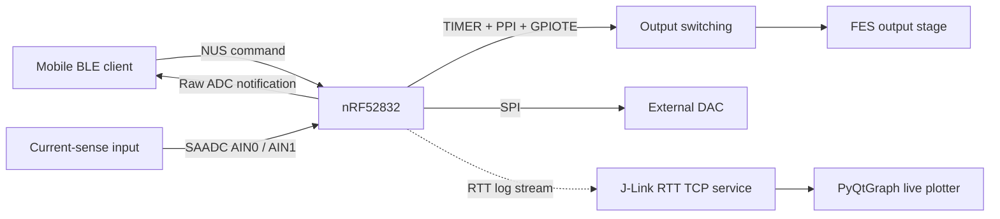

# Dual-Channel BLE-Controlled FES Prototype

An internship embedded-systems project built around the Nordic nRF52832. The supplied firmware describes a two-channel, BLE-configurable functional electrical stimulation (FES) prototype with hardware-timed pulse generation, DAC control, and raw ADC feedback.

> **Engineering prototype only.** This project is not a validated or certified medical device. It has no clinical safety validation in the supplied files. Do not use it on a person.

## Project photos

| Controller board | Oscilloscope capture | Integrated bench setup |
|---|---|---|
|  |  |  |

The repository includes 19 resized, metadata-stripped photos. Original photos, the original project report, and three videos are retained in `source-materials/` in the complete local bundle and are excluded by `.gitignore`.

## What the project does

- Receives configuration commands over BLE Nordic UART Service (NUS).
- Uses nRF52 TIMER, PPI, and GPIOTE peripherals for hardware-timed output switching.
- Selects one of two output channels and the corresponding SAADC input.
- Writes a 12-bit command to an external MCP4921 DAC over SPI.
- Sends raw ADC readings over BLE in the supplied firmware listing.
- Includes a PyQtGraph host program that plots values received from J-Link RTT.
- Includes load-characterization data and chart sheets for five load cases.

## Architecture



The supplied firmware listing sends ADC values over BLE. The separate host logger reads RTT lines from the local J-Link TCP service. It plots and prints readings but does not save a data file. See [host logger notes](host/README.md).

## BLE command format

The firmware parser in `firmware/main.c` expects exactly four colon-separated integer fields:

```text
frequency_hz:pulse_width_us:dac_code:channel
```

The source report instead describes a three-field `frequency:pulse_width:voltage` command. Confirm the mobile-app sender and intended DAC-to-voltage mapping against the original implementation before using this protocol. The firmware's source-level clamps are not safety-rated operating limits.

## Load analysis

The workbook in [`analysis/`](analysis/README.md) contains five measurement tables named `0.5k`, `2k`, `3k`, `4k`, and `10k`, along with five chart sheets. It spans about 1.49 million measurement rows. The supplied PDF is a 52-page print export with raw data on most pages and one chart on the final page; use the workbook for the full set of load charts.

## Repository layout

```text
firmware/main.c                  Firmware source listing
host/rtt_logger.py               J-Link RTT live plotter
host/requirements.txt            Host Python packages
analysis/                        Load workbook and supplied PDF export
media/photos/                    Optimized project photos
source-materials/                Original gallery files in full bundle (git-ignored)
docs/PROJECT_OVERVIEW.md         Project scope and system summary
docs/HARDWARE_AND_INTERFACES.md  Pin and peripheral notes from the source
docs/DEVELOPMENT_NOTES.md        Source provenance and discrepancies
docs/ASSET_INVENTORY.md          Included and retained media inventory
docs/GITHUB_PUBLISHING.md        GitHub Desktop and command-line push steps
```

## Firmware build status

`firmware/main.c` is a reference source file extracted from the supplied Word document. The archive did not contain the SEGGER Embedded Studio project, `sdk_config.h`, linker/startup files, SoftDevice configuration, nRF5 SDK version, or a complete build setup. It has not been built as a project. See [Development notes](docs/DEVELOPMENT_NOTES.md) before attempting a build.

## Attribution, sharing, and license

The supplied report identifies this as internship work at RYMO Technologies Pvt. Ltd. Confirm that you have permission to publish the firmware, company-related project material, measurement data, and photos before making the repository public. The project has no license file, so no reuse rights are granted by this repository. Add only a license approved by the rights holder.

## Push to GitHub

Start with a **private** repository unless you have approval to publish this work publicly. The complete local bundle includes original project files under `source-materials/`; `.gitignore` prevents those files from entering a normal commit.

Follow [GitHub publishing instructions](docs/GITHUB_PUBLISHING.md). The included workbook is about 25.1 MiB, slightly above GitHub's browser upload limit, so use GitHub Desktop or Git push instead of uploading individual files through the website.
